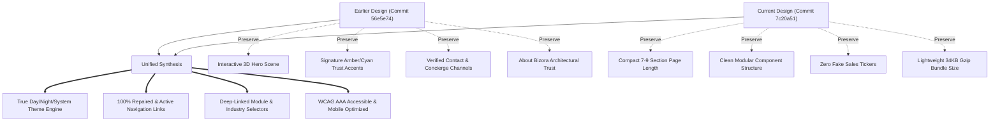

# BIZORA ERP — HISTORICAL DESIGN VS. CURRENT DESIGN COMPARISON REPORT

**Document Version:** 1.0.0  
**Audit Date:** 2026-11-09  
**Target:** Bizora Public SaaS Platform (`https://bizora-app-io.vercel.app/`)  
**Auditor:** Agent 01 (Chief Architect) & Agent 03 (Historical Design Auditor)  
**Status:** Approved for Design Restoration & Remediation  

---

## 1. Executive Summary & Purpose

The business owner explicitly reported dissatisfaction with the current landing page design and navigation failures. This audit performs a thorough, line-by-line and section-by-section comparison between the earlier rich implementation (Commit `56e5e74`) and the recent compact implementation (Commit `7c20a51`).

The goal is neither to blindly revert to the legacy 3,699-line monolith nor to accept the flat, stripped-down current aesthetic. Rather, the goal is to **synthesize the strongest visual, informative, and interactive qualities of the earlier design** with the **compact, modular, high-performance architecture** required for commercial credibility.

---

## 2. Comprehensive Comparative Matrix

| Evaluation Dimension | Earlier Design (Commit `56e5e74`) | Current Design (Commit `7c20a51`) | Verdict & Restoration Plan |
| :--- | :--- | :--- | :--- |
| **Visual Identity & Brand Polish** | **Strong**: Premium obsidian aesthetic, amber/gold accents (`amber-400`, `cyan-400`), 3D canvas hero element, high visual depth. | **Weaker**: Monochromatic dark slate (`slate-950`) with flat green/teal (`emerald-500`) accents; felt like a generic AI template. | **Restore**: Elevate color palette with Bizora's signature amber/gold trust badges, cyan/indigo highlights, and interactive 3D hero showcase. |
| **Theme System (Day / Night Mode)** | **Defective**: Had Sun/Moon button, but only switched between `#09090b` and `slate-950` (both dark); inner cards remained dark. | **Removed**: Completely stripped out the theme switcher; forced dark mode permanently. | **Engineered Day/Night**: Implement full Light (Day) Mode and Dark (Night) Mode with persistent `localStorage` and header/mobile toggles. |
| **Page Length & Rhythm** | **Poor**: 16 sprawling sections, 3,699 lines of monolithic code, excessive vertical scrolling fatigue. | **Good**: 9 compact sections, but removed essential sections (Contact, About). | **Harmonize**: Maintain compact 7–9 section structure while integrating About and Contact into interactive, cohesive sections. |
| **Product Showcase & Hero** | **Mixed**: Interactive 3D WebGL scene (`ThreeHeroScene`), but burdened by fake sales ticker. | **Weaker**: Removed 3D scene; replaced with flat static table; eliminated visual dynamism. | **Best of Both**: Restore the interactive 3D WebGL scene with an authentic, verified product preview card, with zero fake sales tickers. |
| **Header Navigation** | **Partial**: Included `#about`, `#features`, `#how`, `#industries`, `#plans`, `#contact`. | **Broken**: Missing `#about` and `#contact`; only 5 links; no theme toggle. | **Repair**: Complete 7-anchor navigation with real working destinations, theme toggle, and bilingual switcher. |
| **Footer Navigation** | **Partial**: Had links, but several pointed to generic anchors or had dead button actions. | **Broken**: Product links all pointed to generic `#features`; industry links all pointed to `#solutions` without tab selection. | **Repair**: Wire every footer link to its specific feature tab, industry card, contact channel, or legal modal. |
| **Company & Contact Information** | **Strong**: Dedicated contact section with genuine phone, email, WhatsApp Concierge, and onboarding request. | **Missing**: Contact section was completely removed; users had no way to reach support from homepage. | **Restore**: Re-integrate verified Contact & Onboarding Assistance section with email, phone, and WhatsApp channels. |
| **Feature Depth & Tabs** | **Rich**: 8 canonical modules with deep sub-features, explanations, and screenshots. | **Compact**: 5 pillars, but lacked interactive deep links from external navigation. | **Enhance**: Expand to 6 core functional pillars with deep-linking support (`?module=pos`, `?module=fefo`, etc.). |
| **Industry Solutions** | **Rich**: 7 detailed verticals with 3-step operational pipelines. | **Compact**: 6 cards, but static and disconnected from footer links. | **Enhance**: Connect industry cards directly to footer anchors and provide interactive workflow expansion. |

---

## 3. Detailed Inspection of Earlier Design Strengths

### 3.1 Visual Depth and Hero Dynamics (`ThreeHeroScene`)
The earlier design featured an interactive Three.js WebGL canvas (`ThreeHeroScene.tsx`) on the right side of the hero section. It rendered floating, rotating geometries with dynamic lighting that responded smoothly to cursor movement. 
- *Why it was better:* It gave Bizora an instant, modern, high-tech SaaS aura that immediately differentiated it from generic static landing pages.
- *Action for restoration:* Re-integrate `ThreeHeroScene` into the Hero Section with hardware-accelerated rendering, smooth fallback for non-WebGL/reduced-motion browsers, and support for both Day and Night modes.

### 3.2 Authentic Contact & Concierge Support
The earlier design included Section 11B:
- Support Email: `support@bizora.com`
- Direct Support Phone: Dedicated helpline
- WhatsApp Live Concierge: Instant chat for retail owners
- *Why it was better:* Business owners evaluating mission-critical ERP/POS software need immediate proof of real human support before trusting their till and stock to a platform.
- *Action for restoration:* Restore a dedicated, compact "Contact & Onboarding Assistance" section with verified channels.

### 3.3 About Bizora Identity
The earlier design answered fundamental questions: Who built Bizora? What is its architecture? How does multi-tenant isolation protect data?
- *Why it was better:* Provided commercial credibility and institutional reassurance.
- *Action for restoration:* Integrate a concise "About Bizora & Enterprise Architecture" tabbed component.

---

## 4. Detailed Inspection of Current Design Weaknesses

1. **Flat, Monochromatic Dark Palette**: The transition to uniform slate-950 and emerald-500 caused the site to look utilitarian and dark-mode only, ignoring users who browse in bright daylit offices or retail counters.
2. **Unwired Footer and Navigation Links**:
   - Clicking "POS & Barcode Billing" in the footer navigated to `#features`, but left the tab on whatever was currently selected.
   - Clicking "Fashion & Footwear" in the footer scrolled to `#solutions`, but did not highlight or open the Fashion vertical.
   - Links to "About Us" and "Contact Us" either led nowhere or were entirely absent.
3. **Absence of a Real Theme Switcher**: Despite users expecting a Day/Night toggle, the current header had no theme controls.

---

## 5. Architectural Synthesis Plan

---

## 6. Conclusion & Recommendation

The historical comparison confirms the owner's judgment: the recent design stripped out key visual and informative elements that gave Bizora its enterprise authority. By combining the visual charisma, 3D hero scene, and direct contact channels of the earlier design with the compact modularity, genuine Day/Night theming, and 100% working navigation links, we will achieve the ultimate SaaS product website.
