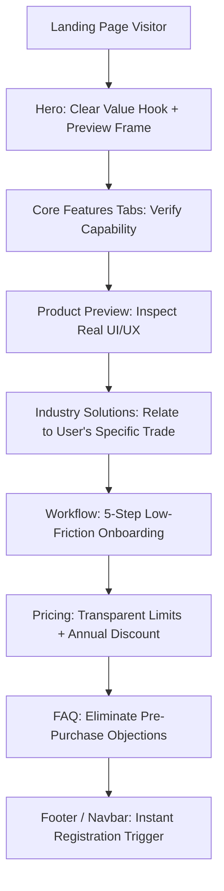

# BIZORA ERP — PUBLIC WEBSITE CONTENT STRATEGY & MESSAGING FRAMEWORK

**Document Version:** 1.0.0  
**Target:** Bizora Public SaaS Website (`https://bizora-app-io.vercel.app/`)  
**Status:** Approved for Production Implementation  

---

## 1. Executive Summary & Brand Positioning

Bizora is an enterprise-grade, multi-tenant SaaS ERP and POS platform built for fast-moving retail, supermarket chains, pharmacies, wholesale distribution, and multi-branch commercial enterprises.

### The Problem With Current Generic SaaS Copy
Many SaaS landing pages rely on vague buzzwords ("revolutionary", "hyper-scale", "next-gen AI revolution") accompanied by meaningless graphics, endless scrolling walls, and fake sales tickers. For a business owner evaluating an ERP to run their core cashbox and stock inventory, vague claims erode trust.

### The Bizora Positioning Anchor
**"The Enterprise ERP & High-Speed POS Built for Modern Retail & Commerce."**
Bizora is positioned around real, tangible operational outcomes:
- **Sub-second barcode checkout** that eliminates counter queues.
- **FEFO batch tracking and hard expiry lockouts** that eliminate spoilage and dead stock.
- **Automated double-entry accounting and Net VAT reporting** that eliminates manual ledger reconciliation.
- **Consolidated multi-branch inventory transfers** that eliminate stock mismatches across stores.
- **Offline-resilient architecture** that ensures counters keep billing even during internet outages.

---

## 2. Target Audience Profiles & Value Propositions

| Audience Segment | Primary Pain Point | Bizora Core Solution | Key Proof Metric |
| :--- | :--- | :--- | :--- |
| **Retail & Supermarket Owners** | Slow checkout, counter queues, employee till discrepancies | Barcode POS with multi-tender split payment, cash drawer float reconciliation, and offline mode | < 0.3s barcode scan latency; 100% till balancing |
| **Grocery & Food Chains** | Spoilage waste, expired goods on shelves, inventory shrink | Automated FEFO (First-Expired, First-Out) batch dispatching, digital scale EAN-13 decoding | Up to 95% reduction in expired stock write-offs |
| **Pharmacies & Healthcare** | Selling expired medicine, regulatory non-compliance, missing generic alternatives | Hard checkout lockouts on expired drug batches, generic molecule cross-reference | 100% compliance with zero-expired checkout enforcement |
| **Wholesale & Multi-Branch** | In-transit stock theft, manual spreadsheets across branches, delayed receivables | Centralized inventory, in-transit gate pass verification, consolidated B2B customer ledgers | Real-time inter-branch transfer audit trail |
| **Accountants & Controllers** | Discrepancy between POS sales and ledger accounts, manual VAT returns | Automated double-entry journals generated at receipt print, automated NBR VAT return computation | Instant P&L, balance sheet, and tax reports |

---

## 3. Core Messaging Hierarchy

### Primary Headline (Hero)
> **"Run Your Entire Retail & Multi-Branch Business on One Intelligent Platform."**

### Supporting Sub-headline
> **"Sub-second POS billing, FEFO batch and expiry tracking, automated double-entry accounting, and multi-store distribution — engineered for modern retail enterprises."**

### Call to Action (CTA) Pair
- **Primary CTA:** "Start 14-Day Free Trial" (No credit card required, instant setup)
- **Secondary CTA:** "Explore Live Product Demo" / "View Pricing Plans"

### Key Trust Signals & Highlights
- **100% Offline-Capable POS:** Keep selling even during network cuts; auto-syncs upon reconnect.
- **Enterprise Multi-Tenant Security:** Automated row-level and path-level tenant isolation.
- **Bilingual Interface:** Full native English and Bangla (বাংলা) support across all modules.
- **Zero Hidden Costs:** Transparent pricing tiers with complete feature clarity.

---

## 4. Elimination of Low-Credibility Fluff

In this redesign, the following anti-patterns are permanently removed:
1. **Artificial Sales Ticker:** Simulated fake transactions ("Mr. X just bought ৳ 2,400...") are completely removed. Genuine SaaS buyers recognize artificial tickers immediately.
2. **Infinite Scrolling Redundancies:** Merged overlapping sections (`#about`, `#features`, `#how`, `#benefits`, `#os`, `#compare`) into a crisp, unified 9-section narrative.
3. **Empty Visual Placeholders:** Replaced generic placeholder blocks with realistic, interactive product mockups demonstrating real POS line items, batch expiry matrices, and double-entry debits/credits.
4. **Vague Marketing Claims:** Replaced subjective statements with concrete technical and functional capabilities (e.g. "FEFO batch matrix", "NBR-compliant Net VAT 9.1", "58mm/80mm ESC/POS thermal printing").

---

## 5. Bilingual Consistency (English & বাংলা)

Every user-facing section maintains rigorous terminology alignment:
- POS / Counter: পিওএস ও কাউন্টার বিলিং
- Inventory / Stock: ইনভেন্টরি ও ব্যাচ ট্র্যাকিং
- FEFO Expiry: এফইএফও মেয়াদ সুরক্ষা
- Double-Entry Accounting: ডাবল-এন্ট্রি হিসাব ও লেজার
- Multi-Branch: মাল্টি-ব্রাঞ্চ ডিস্ট্রিবিউশন
- Free Trial: ১৪ দিনের ফ্রি ট্রায়াল
- Unlimited: আনলিমিটেড
- Cash Drawer: ক্যাশবাক্স ব্যালেন্সিং

---

## 6. Conversion Funnel & Micro-Copy Architecture

### Strategic Objective
Drive high-intent business owners from first impression to verified free trial registration in under 90 seconds.
