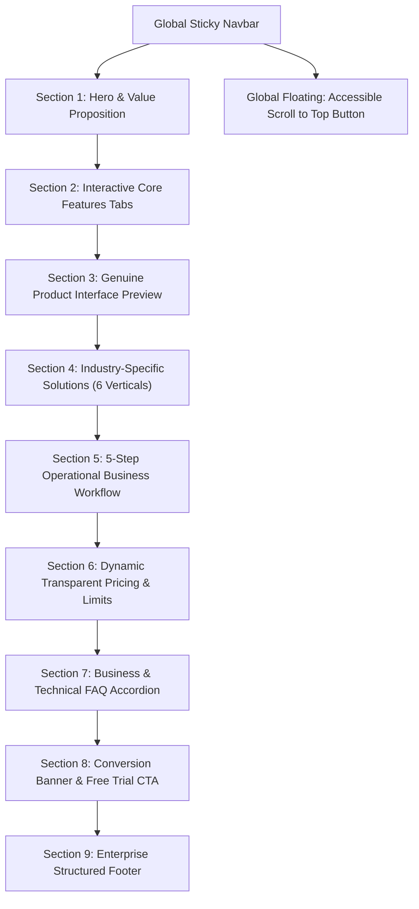

# BIZORA ERP — WEBSITE INFORMATION ARCHITECTURE & SITEMAP

**Document Version:** 1.0.0  
**Target:** Bizora Public SaaS Website (`https://bizora-app-io.vercel.app/`)  
**Status:** Approved for Production Implementation  

---

## 1. Information Architecture Overview

The redesigned Bizora homepage replaces the 3,699-line monolithic, unfocused structure with an intentional, high-converting 9-section architecture plus global floating utilities.

---

## 2. Detailed Section Breakdown & Responsibilities

### Section 0: Global Sticky Navbar (`Navbar.tsx`)
- **Brand Identity:** Bizora ERP logo with live status indicator pill.
- **Bilingual Switcher:** Fast, 1-click toggle between English (`EN`) and Bangla (`বাং`).
- **Primary Anchors:**
  - `Features` (`#features`)
  - `Solutions` (`#solutions`)
  - `Product UI` (`#preview`)
  - `Pricing` (`#pricing`)
  - `FAQ` (`#faq`)
- **Action Buttons:**
  - "Sign In" (routes to `/business` portal login or opens auth modal)
  - "Start Free Trial" (highlighted emerald gradient CTA button)
- **Mobile Responsive Drawer:** Clean slide-over navigation with touch targets $\ge 44\text{px}$.

---

### Section 1: Hero & Value Proposition (`HeroSection.tsx`)
- **Badge Pill:** "⚡ Enterprise Multi-Tenant ERP & High-Speed POS"
- **Primary Title:** "The Intelligent ERP & POS Built for Modern Retail & Commerce"
- **Sub-headline:** "Run sub-second barcode billing, FEFO batch expiry control, automated double-entry accounting, and multi-store distribution on a single unified cloud platform."
- **CTA Actions:**
  - "Start 14-Day Free Trial" &rarr; Routes to signup with trial plan parameter
  - "View Pricing & Features" &rarr; Smoothly scrolls to `#pricing`
- **Product Preview Frame:**
  - Interactive mock dashboard showing active till revenue, transaction count, offline sync badge, and live till status without artificial timer loops.
  - Three key metric highlights: `< 0.3s Scan Latency`, `100% Offline-Capable`, `Zero Dead Stock with FEFO`.

---

### Section 2: Interactive Core Features Tabs (`CoreFeaturesSection.tsx`)
Organized into 5 distinct architectural pillars:
1. **High-Speed POS & Billing:** Quick-sale till, multi-tender split (Cash, Card, bKash, Nagad), cash drawer float reconciliation, 58mm/80mm thermal receipt printing.
2. **FEFO Batch & Expiry Control:** Oldest-expiry automated dispatch, weighing scale EAN-13 barcode integration, 30/60/90-day expiry radar, low-stock reorder drafts.
3. **Double-Entry Ledgers & Net VAT:** Instant journal posting upon bill completion, automated chart of accounts, expense voucher approvals, NBR Net VAT 9.1 returns.
4. **Multi-Branch & Warehouse Transfers:** Central warehouse inwarding, in-transit gate pass tracking, inter-branch stock replenishment, unified multi-branch P&L.
5. **Real-Time Analytics & Profit Intelligence:** Gross margin tracking, fast-moving vs slow-moving stock matrix, customer receivables aging, automated daily cashbox summaries.

---

### Section 3: Genuine Product Interface Preview (`ProductPreviewSection.tsx`)
Showcases four high-fidelity, interactive product interfaces:
- **Tab 1: Touch & Barcode POS Terminal:** Real line items, barcode scanner input, split payment modal, receipt preview.
- **Tab 2: FEFO Expiry Matrix:** Real product lots with manufacture dates, expiry countdowns, status tags (Healthy, Warning, Locked).
- **Tab 3: Double-Entry Financial Journal:** Debit/Credit balanced ledger entries, chart of accounts codes, invoice references.
- **Tab 4: Multi-Branch Network View:** Branch stock distributions, pending transfers, in-transit status.

---

### Section 4: Industry Solutions Grid (`IndustrySolutionsSection.tsx`)
Tailored workflows for 6 key commercial verticals:
1. **General Retail & Supermarket:** Rapid barcode checkout, cash drawer float, split tender.
2. **Grocery & Fresh Produce:** FEFO batch rotation, EAN-13 digital scale barcodes, spoilage prevention.
3. **Fashion, Shoes & Apparel:** Size, color, fit variant matrix, barcode label printing.
4. **Electronics & Mobile Phones:** Unique IMEI & serial tracking, warranty slips, repair tracking.
5. **Pharmacy & Healthcare:** Batch expiry enforcement, generic molecule lookup, supplier return slips.
6. **Wholesale & Distribution:** Bulk carton inwarding, B2B credit terms, gate passes.

---

### Section 5: 5-Step Operational Business Workflow (`WorkflowSection.tsx`)
A clear, linear onboarding progression that demystifies adopting Bizora:
- **Step 01: Setup & Customization:** Configure store outlets, tax rates, cashboxes, and staff roles in 2 minutes.
- **Step 02: Stock Inwarding:** Scan barcodes, assign lot numbers and expiry dates, set reorder points.
- **Step 03: Fast Counter Checkout:** Sub-second barcode scanning, multi-tender split, thermal receipt printing.
- **Step 04: Automated Financial Sync:** Instant double-entry journal posting and VAT calculation.
- **Step 05: Branch Scale & Insights:** Monitor multi-store revenues, transfer stock with gate passes, track live profits.

---

### Section 6: Dynamic Transparent Pricing & Limits (`PricingSection.tsx`)
- **Billing Cycle Switcher:** Monthly vs Annual toggle (with verified 20% annual discount badge).
- **Dynamic API Sync:** Real-time fetching from `/api/platform/public-plans` with robust offline fallback to standard packages (`trial`, `basic`, `pro`, `enterprise`).
- **Feature Highlights & Quantitative Limits:** Stores, users, employees, products, invoices, warehouses, cloud storage.
- **Deep-Dive Action:** "View Full Feature Breakdown" button opening the authoritative `PlanDetailsModal`.
- **Direct Signup CTA:** Directs straight to the onboarding funnel with selected plan pre-populated.

---

### Section 7: Business & Technical FAQ Accordion (`FaqSection.tsx`)
- Structured according to real business questions (Offline billing, data export, printer compatibility, multi-branch, security, migration).
- Fully accessible keyboard navigation (`Space`/`Enter` expansion).
- Backed by Schema.org `FAQPage` JSON-LD structured data.

---

### Section 8: Final Call to Action Banner (`CtaBannerSection.tsx` / `HeroSection.tsx`)
- Bold, high-contrast banner inviting the visitor to start their 14-day free trial immediately without payment info.

---

### Section 9: Enterprise Structured Footer (`FooterSection.tsx`)
- **Column 1: Brand & Credentials:** Logo, mission statement, SSL 256-bit encryption badge, system uptime status.
- **Column 2: Platform Modules:** Direct anchors to POS, Inventory, Accounting, Multi-Branch, E-commerce, Reports.
- **Column 3: Solutions & Industries:** Direct links to Retail, Grocery, Pharmacy, Fashion, Electronics, Wholesale.
- **Column 4: Legal & Governance:** Direct modal triggers for Privacy Policy, Terms of Service, Cookie Preferences, Refund Policy, Security Whitepaper, and Account Deletion Request.
- **Bottom Bar:** Dynamic copyright year, domain indicator, social links, and security compliance statement.

---

### Global Utility: Floating Scroll to Top (`ScrollToTop.tsx`)
- Fixed at `bottom-6 right-6` with `z-50`.
- Automatically appears with smooth transition when scroll depth exceeds `300px`.
- One-click smooth scroll to `window.scrollTo({ top: 0, behavior: 'smooth' })`.
- Keyboard accessible (`Tab` focusable, `Enter` / `Space` triggerable) with `aria-label="Scroll to top"`.
